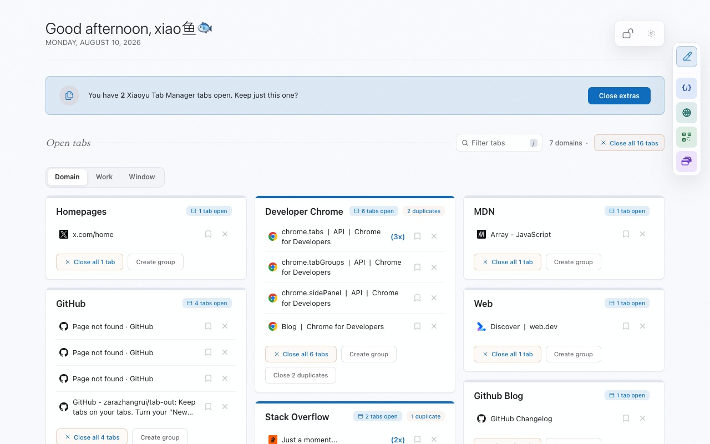
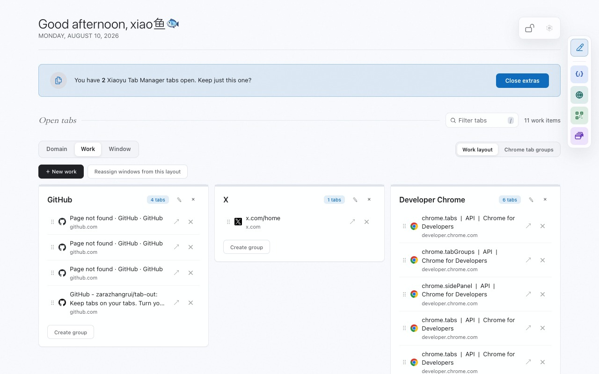
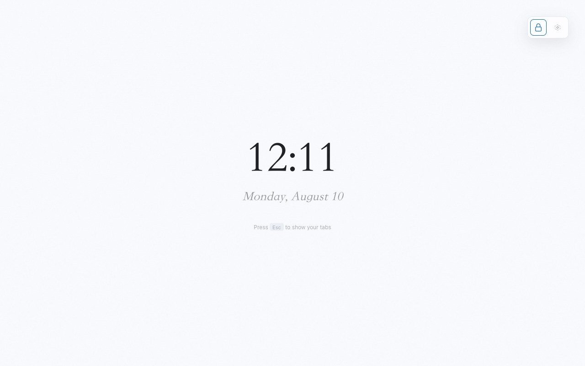
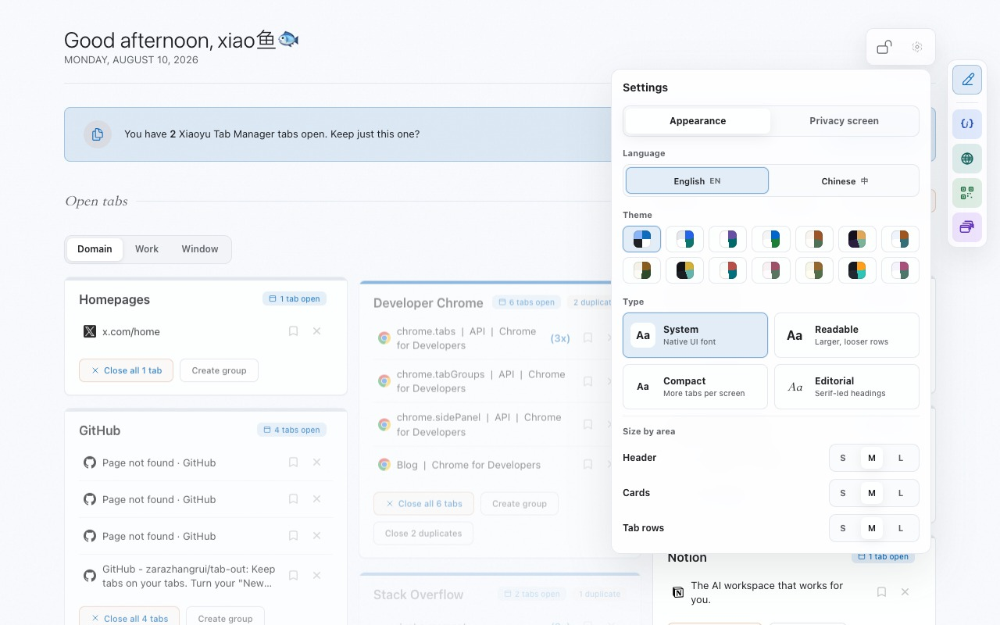
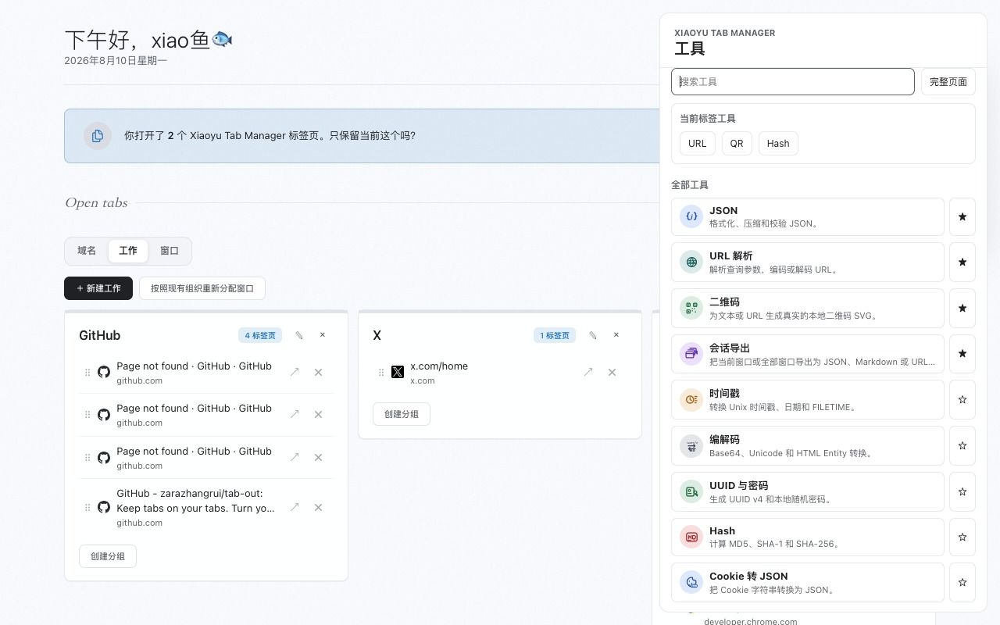

<div align="center">

<h1>Xiaoyu Tab Manager</h1>

<hr />

<h3>The Local-First New Tab Dashboard for Chrome, Edge & Brave</h3>

<p>
  
  
  
  
</p>

<p>
  English | <a href="./README.zh-CN.md">中文</a> | <a href="./CHANGELOG.md">Changelog</a>
</p>

</div>

**A polished local new-tab command center for Chromium browsers.**

Xiaoyu Tab Manager replaces the default new tab page with a visual dashboard for open tabs and saved shortcuts. Domain, Work, Window, and Shortcuts preserve familiar site grouping, add persistent logical workspaces, reorganize real Chrome windows, and show grouped custom page mappings. Chrome Tab Groups remain available inside Work.

No server. No account. No telemetry. No build step. Load the `extension/` folder and use it.

Release notes are tracked in [`CHANGELOG.md`](./CHANGELOG.md).

---

## Highlights

- **Text-first command desk**: a quieter new-tab layout with clear hierarchy, compact controls, and no decorative brand icon in the page header.
- **Three organization views**: switch between Domain, Work, and Window without conflating logical projects with real browser containers.
- **Grouped Shortcuts**: persistent mapping cards reuse an exact open URL by default; right-click **Open a new copy** to intentionally keep duplicates.
- **Persistent work layout**: start from domain cards, drag exact pages between work items, and collect new pages in a domain-grouped inbox.
- **Real window reorganization**: drag a tab to another window with immediate effect and undo, or drop it on the permanent “New window” target to create a background window without losing the next target.
- **Fast tab filtering**: press `/` and filter cards, chips, URLs, and group names in real time.
- **Search operators**: narrow results with `domain:`, `group:`, `url:`, and `saved:`; fuzzy matches are highlighted.
- **Side Panel command center**: search, jump, save, close, dedupe, restore recently closed tabs, and use local tools without leaving the current page.
- **Docked Command Center**: desktop layouts keep tools one click away with a compact dock and sortable favorite tools.
- **FeHelper-inspired local tools**: open a full three-column local tools workbench from the toolbar icon, Command Center, or omnibox for JSON, URL parsing, codecs, timestamps, real QR SVGs, UUID/passwords, hashes, cookies, and session export.
- **Keyboard and omnibox entry points**: use `xtm` in the address bar for search/actions, or commands for panel/session/privacy workflows.
- **Accessibility and motion controls**: icon buttons have accessible labels, chips support keyboard activation, and system reduced-motion preferences are respected.
- **Privacy mode for screen sharing**: click the lock or press `Esc` to hide the tab dashboard behind a clean clock screen.
- **Pinned tabs are protected**: pinned tabs are excluded from cards, counts, duplicate cleanup, and bulk-close actions.
- **One-click duplicate cleanup**: repeated URLs are marked and can be cleaned while keeping one copy.
- **Save for later**: stash a tab into a local checklist before closing it.
- **Auto-refresh**: tab open, close, navigation, and group changes refresh the dashboard automatically.
- **Bilingual UI**: switch between English and Simplified Chinese from Settings.
- **More themes, easier switching**: choose from 14 built-in palettes in the lightweight Settings panel.
- **Local-first privacy posture**: settings and saved tabs stay on your machine.

---

## Screens and Controls



The page header keeps the greeting and date visible without repeating the product name. The product identity stays in the browser UI and footer so the new tab page reads lighter.

An independent **keyword search** sits beside the greeting, separate from the open-tab filter. Click **Manage** to add a keyword, page name, full URL, and optional aliases (one per line). Search by group, page name, or alias without an `xtm` prefix. Group search prefers exact names, falling back to prefixes; names and aliases support case-insensitive substring matching across groups. Results show their group and open-window status. Existing mappings remain compatible and persist locally.

Search and **Shortcuts** cards share the same data and opening rules. Click or Enter reuses an exact URL in the current normal window first, then the most recently used exact match elsewhere; otherwise it opens one foreground tab. Query parameters, ordering, and fragments remain significant. No domain fallback or existing-tab removal is performed. Right-click **Open a new copy**, or use **Shift+Enter** in search, to explicitly open another copy. A changed, closed, or inaccessible target reports failure instead of blindly creating duplicates. The original tab filter is hidden only in Shortcuts and retains its value when switching back.

Use **＋ (Add to shortcuts)** on a real tab row in Domain, Work, Window, or Chrome Tab Groups to prefill its title and full URL, then choose a group and save. Manage also supports local JSON export and preview-before-merge import, limited to 2 MiB / 5,000 mappings. Matching group + exact URL preserves local identity, title, and URL and only unions aliases; repeated import is idempotent and invalid files are rejected entirely. Backups contain full URLs and parameters: keep internal links private and out of public repositories. Nothing is uploaded.

The mapping manager uses collapsible keyword groups with page counts. Existing groups start collapsed on page load; expansion is retained within the current dashboard, and adding or editing a page reveals its group. Long page names and URLs are shortened visually to one line, with full text available on hover.

The top-right controls are intentionally compact:

- **Lock**: toggles privacy mode.
- **Settings**: opens language, theme, type, and privacy-screen options.

**Settings → Tabs → Automatically merge Xiaoyu pages** optionally keeps only one dashboard. It is off by default. Starting with the next dashboard load, it keeps the newest-created Xiaoyu dashboard and closes other unpinned dashboards in normal windows. Turning the setting on does not immediately close existing pages; turning it off restores the original prompt and manual button. Web pages, other extensions, Blue, incognito, and pinned tabs are not automatically closed. Unsaved input in old dashboards is lost, and a window containing only an old dashboard may close. This setting is independent of identical-webpage URL reuse.

Available themes:

| Theme | Tone |
| --- | --- |
| Adaptive Glow | Follows Chrome/Edge light or dark appearance |
| Ivory Page | Minimal white workspace |
| Material Orbit | Clean Material-inspired color system |
| Cupertino Mist | Soft Apple-style glass and mist |
| Warm Parchment | Soft editorial paper |
| Midnight Voyage | Dark, quiet workspace |
| Frost Field | Crisp blue-white |
| Forest Isle | Muted green and earth |
| Graphite Gold | Dark graphite with gold accents |
| Coral Tide | Coastal teal with coral |
| Plum Shade | Low-saturation plum |
| Matcha Haze | Calm green reading mode |
| Ember Slate | Dark slate with warm energy |
| Lavender Breeze | Light lavender with mint |

Additional release screenshots:

| Work Layout | Privacy Mode |
| --- | --- |
|  |  |

| Theme Picker | Chinese UI |
| --- | --- |
|  |  |

---

## Install

The first public commit is a complete functional baseline. Subsequent updates should be grouped by independent feature or fix, keeping every commit runnable. Run `npm test` and `npm run validate` before pushing, plus isolated Chrome regression tests for UI changes. Keep personal configuration, diagnostics, browser data, and generated ZIPs out of Git.

1. Clone the repo:

```bash
git clone https://github.com/Xiaoyu-Pro/xiaoyu-tab-manager.git
cd xiaoyu-tab-manager
```

2. Open your browser extension page:

```text
chrome://extensions
edge://extensions
brave://extensions
```

3. Enable **Developer mode**.
4. Click **Load unpacked**.
5. Select the `extension/` folder in this repo.
6. Open a new tab.

To update later, pull the latest code and click **Reload** on the extension page:

```bash
git pull
```

---

## Debugging

For normal manual testing, use Chrome and load the `extension/` folder from `chrome://extensions`.

For automated extension testing, use **Chrome for Testing** instead of the regular branded Chrome app. Recent branded Chrome builds can block command-line unpacked-extension loading, while Chrome for Testing keeps that workflow available for automation.

This workspace can keep a local browser binary at:

```text
tools/chrome-for-testing/
```

That directory is intentionally ignored by Git because it is large and only needed for local debugging. It is not included in the Chrome Web Store / Edge Add-ons zip packages.

Launch the latest local extension build:

```bash
npm run dev:host
```

By default the script also prepares a repeatable manual regression scenario on every launch: pinned homepages, duplicate URLs, native Chrome Tab Groups, a collapsed group, mixed ungrouped tabs, a recently closed tab, saved-for-later items, saved sessions, activity metrics, achievements, and local tool favorites/state. It cleans previously seeded tabs before recreating the scenario, so repeated `npm run dev:host` runs do not stack duplicate seed tabs.

Use `scripts/launch-chrome-testing.sh --no-seed-tabs` for a clean browser, or `--reset-profile` for a fresh profile before seeding.

Optional overrides: `CHROME_BIN`, `PROFILE_DIR`, `REMOTE_DEBUGGING_PORT`, `SEED_TABS`, `SEED_DELAY_MS`, `SEED_CLEANUP`, and `SEED_REQUIRED`.

## Validation

No build step is required, but the repo includes lightweight local checks for extension changes:

```bash
node tests/run-tests.mjs
node scripts/validate-extension.mjs
```

The validator checks `manifest.json`, extension script syntax, service script loading order, and store ZIP contents for common local-only files.

---

## Keyboard Shortcuts

| Key | Action |
| --- | --- |
| `/` | Focus the open-tabs filter field |
| `Esc` while the filter is focused | Clear and blur the filter |
| `Esc` elsewhere | Toggle privacy mode |
| `Ctrl/Cmd + Shift + G` | Open Work / Chrome Tab Groups |
| `Ctrl/Cmd + Shift + Y` | Open the Side Panel |

Omnibox keyword: type `xtm` then a query or action such as `panel`, `save-session`, `dedupe`, or `privacy`.

---

## Feature Details

### Tab Dashboard

Xiaoyu Tab Manager reads your open tabs with `chrome.tabs.query({})`, filters out browser-internal pages, and renders useful cards:

- Domain keeps the original site cards
- Work persists exact-page assignments with drag-and-drop, CRUD, an inbox, and native group creation
- Window shows every normal window, supports real cross-window moves with undo, and always keeps one virtual “New window” drop target that is not included in the real-window count
- a Homepages card for landing pages like Gmail, X, YouTube, LinkedIn, and GitHub
- Chrome Tab Groups remains an always-discoverable Work subview
- duplicate badges for repeated URLs
- localhost labels with port numbers

Dragging in Work changes only Xiaoyu Tab Manager's logical organization; dragging in Window immediately calls the Chrome API. Dropping a tab on “New window” creates a real normal window in the background, keeps the virtual target available for the next tab, and supports the same undo path as an ordinary window move. The batch “Reassign windows from this layout” action shows move, reuse, creation, protected-tab, and mixed-group counts before it changes anything.

### Search

The search pill uses one local index for open tabs, Chrome group titles, saved-for-later items, and saved sessions. Supported filters:

| Filter | Example |
| --- | --- |
| `domain:` | `domain:github auth` |
| `group:` | `group:work api` |
| `url:` | `url:docs extensions` |
| `saved:` | `saved:true article` or `saved:false github` |

### Side Panel

The Side Panel keeps Xiaoyu Tab Manager available while you stay on the current page:

- search open tabs, saved-for-later items, and saved sessions
- open from `Ctrl/Cmd + Shift + Y` or omnibox actions such as `xtm panel`
- jump to a tab, save it for later, or close it
- clean duplicates while keeping one copy
- restore browser-level recently closed tabs/windows via `chrome.sessions`
- save the current browsing session
- view Tab Health, weekly stats, top domains, and achievements
- use a compact local tool directory with favorites, recent tools, current-tab URL shortcuts, and a link to the full Tools workbench

### Local Tools

The full Tools workbench opens from the extension toolbar icon, the Command Center, and omnibox entries such as `xtm tool json`.

Initial tools are local-only: JSON format/minify/validate with tree preview and error diagnostics, URL parsing with query tables, Base64/Unicode/HTML entity codecs, timestamp and FILETIME conversion with cards, real QR SVG generation, UUID/password generation, MD5/SHA hashes, Cookie-to-JSON, and session export as JSON, Markdown, or URL lists.

### Chrome Tab Groups

Domain cards can create native Chrome Tab Groups. Group cards can be renamed, recolored, collapsed/expanded, ungrouped, or saved as a session. Saved sessions appear on the main dashboard and restore into the current window with the Chrome tab group rebuilt.

### Closing Behavior

Each row-level close button targets one exact Chrome `tabId`, so closing a tab keeps other instances of the same URL open. Bulk close actions use exact URL sets, keeping them scoped to the tabs shown in the card instead of unrelated pages on the same host.

Pinned tabs are skipped by every bulk-close and duplicate-cleanup action.

### Reuse Identical Tabs

Turn on **Settings → Tabs → Reuse identical tabs**. Then load a URL in a new foreground tab or click a link that opens a new foreground tab. If an existing page in the same browser profile has the exact URL, Xiaoyu switches to it, closes only the new tab, and shows a brief Chrome toolbar message. No system notification or website permission is needed. Query parameters, their order, and fragments are all compared. The feature is off by default and leaves existing-tab navigation, reloads, background tabs, and session restores alone.

For a foreground tab opened by a link, Xiaoyu also checks address changes during the first two seconds of its initial load, as long as Chrome still reports the same opener. This covers early redirects and in-page URL changes, including redirects across domains. It stops checking once the initial load completes.

Links opened by desktop apps such as Codex can also qualify when Chrome opens them in an existing window and reports an already loaded opener. Using Chrome's **Duplicate** command deliberately keeps both copies.

### Save for Later

The bookmark button saves a tab into `chrome.storage.local` before closing it. Saved items stay local and can be checked off into the archive.

### Privacy Mode

Privacy mode hides the tab dashboard and shows a minimal clock/date screen. It is useful before screen sharing or recording. You can customize whether the privacy screen shows:

- clock
- date
- custom text
- external favicon requests

### Themes and Language

Theme choice is stored in `localStorage` and applied before the page paints, so the selected theme does not flash back to the default on reload.

Language choice is also stored locally and applied early. The switch affects fixed UI labels only; tab titles, URLs, Chrome group names, and user-entered text are not translated or modified.

---

## Privacy

Xiaoyu Tab Manager is local-first.

Stored locally:

- saved-for-later tabs
- saved sessions
- lightweight activity stats and achievements
- privacy mode state and settings
- view mode
- language choice
- theme choice
- favicon cache

External favicon requests can be disabled from privacy settings. When disabled, cached favicons can still render, but new domains will not call the icon service.

The only routine external request, when enabled, is:

- `icons.duckduckgo.com` for favicons, cached locally for 7 days

No Google Fonts are used. Fonts come from system font stacks.

Privacy mode does not provide a web search box or change the browser search provider.

Store upload packages are generated locally into `dist/` with `npm run package`.
The ZIP files are intentionally ignored by Git and should be uploaded to the Chrome Web Store / Edge Add-ons from the local workspace, not committed to GitHub.

---

## Permissions

The extension currently requests:

| Permission | Why it is needed |
| --- | --- |
| `tabs` | Read, focus, close, and group open tabs |
| `storage` | Persist saved tabs, sessions, stats, privacy settings, and view mode |
| `tabGroups` | Read, render, create, update, collapse, and ungroup Chrome Tab Groups |
| `sidePanel` | Show the Side Panel command center |
| `sessions` | Show and restore recently closed browser tabs/windows |

---

## Tech Stack

| Area | Implementation |
| --- | --- |
| Extension platform | Chrome Manifest V3 |
| UI | Plain HTML, CSS, JavaScript |
| Storage | `chrome.storage.local` and `localStorage` |
| Sound | Web Audio API |
| Animations | CSS transitions and JavaScript particles |
| Build | None |

Everything runs locally in the extension. The background service worker owns browser-level entry points such as the toolbar Tools shortcut, badge count, commands, omnibox actions, side panel, and lightweight session actions.

---

## Attribution and License

Xiaoyu Tab Manager is distributed under the Apache License, Version 2.0.

This project is a modified derivative of **[Super Tab Out](https://github.com/SivanCola/super-tab-out)** by **Sivan**, licensed under Apache-2.0. Super Tab Out is itself based on **[Tab Out](https://github.com/zarazhangrui/tab-out)** by **Zara Zhang**, licensed under the MIT License.

The Apache-2.0 license text is in [`LICENSE`](./LICENSE). Required upstream MIT copyright and permission notices are preserved in [`NOTICE`](./NOTICE). Please do not remove those notices from substantial copies or distributions.

Xiaoyu Tab Manager adds persistent Work and Window organization, cross-window drag-and-drop, safer exact-tab operations, favicon restoration, personal greeting, security hardening, Manifest V3 updates, bilingual UI, privacy mode, and local-first saved-tab workflows.

This project is not affiliated with Google, Chrome, Microsoft Edge, Brave, DuckDuckGo, or the upstream Super Tab Out and Tab Out authors. Product names and service names are used only to describe compatibility or attribution.

Apache-2.0. See [`LICENSE`](./LICENSE) and [`NOTICE`](./NOTICE).
