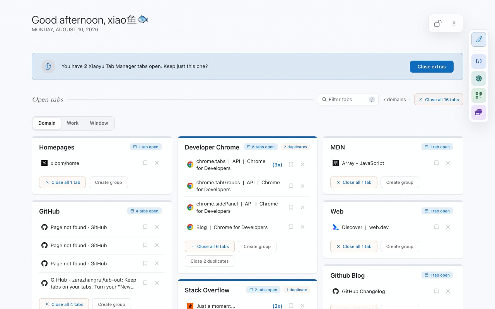
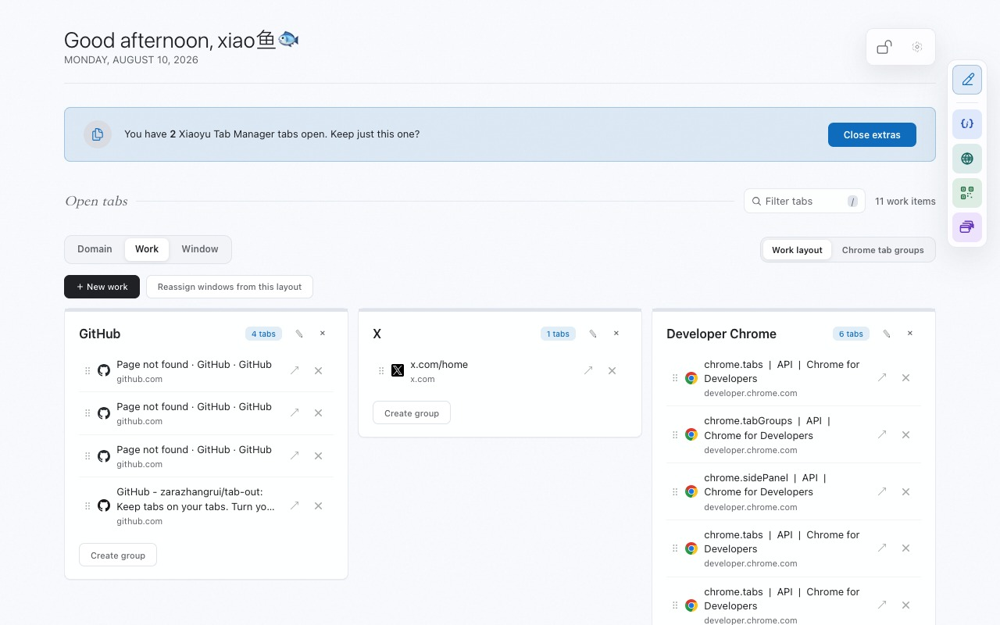
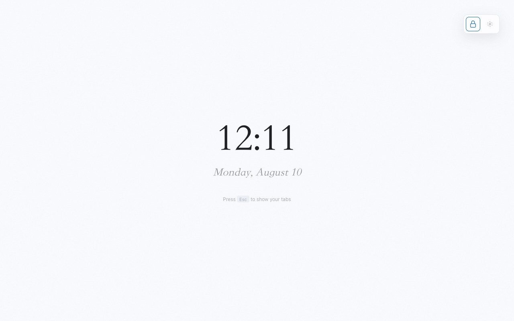
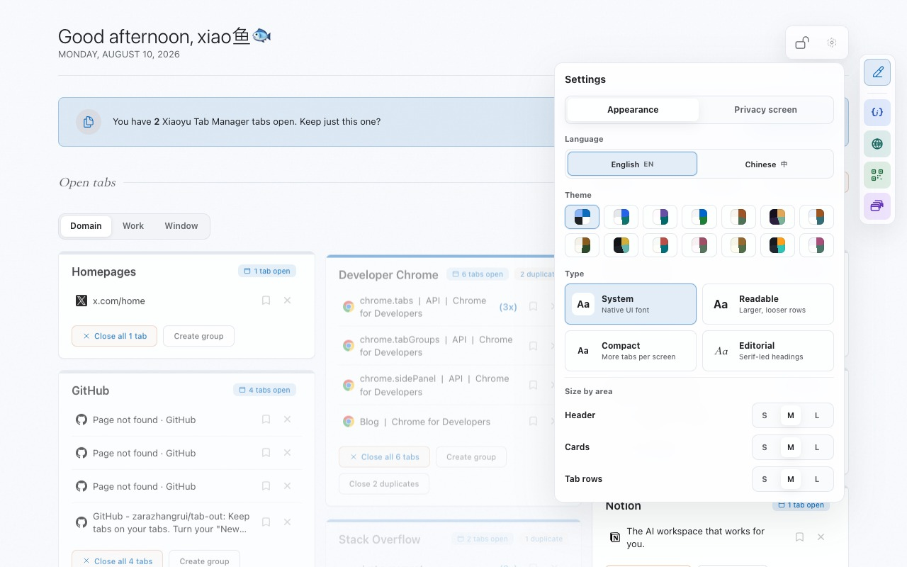
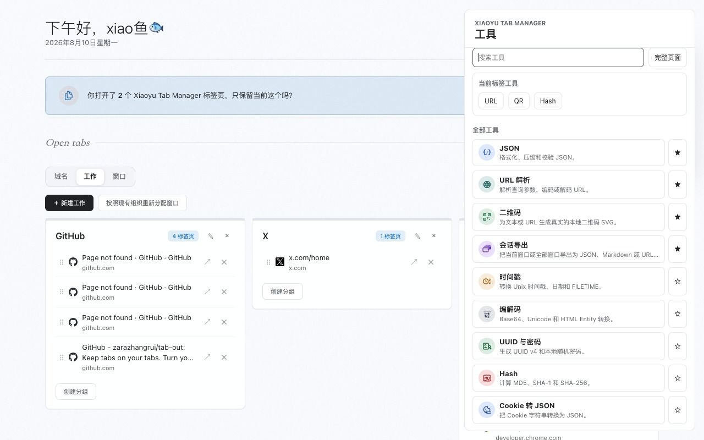

# Xiaoyu Tab Manager

[English](./README.md) · 简体中文

**一个面向 Chromium 浏览器的本地新标签页控制台。**

Xiaoyu Tab Manager 会替换默认新标签页，把你打开的标签集中成一个清爽的可视化面板。它提供“域名 / 工作 / 窗口 / 快捷”四个入口：既能沿用域名聚合、长期保存工作归属、重排真实 Chrome 窗口，也能按自定义映射分组直达常用页面；Chrome 原生 Tab Groups 位于工作视图内。

不需要服务器。不需要账号。不做遥测。没有构建步骤。加载 `extension/` 文件夹即可使用。

版本记录见 [`CHANGELOG.zh-CN.md`](./CHANGELOG.zh-CN.md)。

---

## 核心优势

- **文字优先的控制台布局**：新标签页层级更清楚，右上角控件更集中，页头不再重复品牌名称。
- **三种组织方式**：在“域名 / 工作 / 窗口”之间切换，逻辑工作和真实窗口互不混淆。
- **分组快捷入口**：“快捷”页按映射分组展示持久卡片；普通点击复用完整网址相同的已有页面，右键选择“新开副本”则明确保留多份。
- **长期工作编排**：从现有域名卡片开始，通过拖拽重新归属；新页面进入按域名整理的“待整理”。
- **真实窗口重排**：把标签拖到另一个窗口会立即生效并可撤销，也可以拖到始终存在的“新窗口”目标，在后台创建真实窗口并继续保留下一个虚拟目标。
- **快速过滤标签**：按 `/` 后可实时过滤卡片、标签、URL 和分组名。
- **搜索过滤语法**：支持 `domain:`、`group:`、`url:` 和 `saved:`，并高亮匹配内容。
- **侧边栏控制台**：不离开当前网页也能搜索、跳转、稍后再看、关闭、清理重复、恢复最近关闭标签和使用本地工具。
- **停靠式 Command Center**：桌面布局中可从紧凑 dock 一键打开工具，并支持收藏工具排序。
- **借鉴 FeHelper 的本地工具箱**：可从工具栏图标、Command Center 或地址栏打开三栏完整工具工作台，覆盖 JSON、URL 解析、编解码、时间戳、真实二维码 SVG、UUID/密码、Hash、Cookie 和会话导出。
- **快捷键与地址栏入口**：在地址栏输入 `xtm` 可搜索或执行动作，也可用 commands 打开侧边栏、保存会话和切换隐私模式。
- **无障碍与动效控制**：图标按钮补齐可访问标签，标签 chip 支持键盘触发，并尊重系统减少动态效果设置。
- **适合屏幕共享的隐私模式**：点击锁图标或按 `Esc`，把标签面板隐藏成简洁的时钟屏幕。
- **固定标签保护**：固定标签不会出现在卡片、统计、重复清理或批量关闭动作中。
- **一键清理重复页**：重复 URL 会被标记，可一键保留一份并关闭多余副本。
- **稍后再看**：关闭前可把标签保存到本地清单。
- **自动刷新**：打开、关闭、跳转标签以及分组变化都会自动刷新面板。
- **中英文界面**：可在设置中切换 English / 简体中文。
- **更多主题，更好切换**：内置 14 套主题，并集中在轻量设置面板中。
- **本地优先的隐私策略**：设置和保存的标签都留在你的机器上。

---

## 界面与控件



页头展示问候语和日期，不再重复展示产品名。产品身份保留在浏览器 UI 和页脚中，让新标签页更轻。

页头问候语右侧提供独立的**快捷搜索**，不影响下方“过滤标签页”：点击搜索框里的“管理”，填写关键词、页面名称、完整网址及选填的别名（每行一个）；同一个关键词可添加多个页面。直接输入分组、页面名称或别名（无需 `xtm` 前缀），下拉列表只展示你设置的页面。组名支持完整词优先及前缀匹配，页面名称和别名支持跨组包含匹配，忽略大小写。例如搜索 `argall` 可同时找到“看板”和“tce”中的同名页面，结果末尾标明分组以及“已打开 · 窗口 N”。映射在本机长期保存，旧记录不需要重新添加。

搜索和“快捷”卡片共用同一份数据与打开规则：点击或回车时，优先切回当前窗口完整网址相同的已有页，其次其他普通窗口最近使用的精确页面；没有匹配才新建前台页。参数、参数顺序和 `#` 片段都参与匹配，不按域名猜测，不关闭已有标签。右键“新开副本”或搜索中 `Shift+Enter` 总是新开一份。目标关闭、变址或激活失败会提示重试，不盲目另开。原“过滤标签页”在快捷视图暂时隐藏，切回后保留原值。

在域名、工作、窗口或 Chrome 标签组里的标签行点击 **＋（加入快捷搜索）**，即可预填真实标题和完整 URL，选组后保存。管理弹层提供本地 JSON 导出和导入：导入先预览再确认，按组名＋完整 URL 合并，保留本机 ID、名称和网址，只补充别名；重复导入不重复添加。无效文件、超过 2 MiB 或 5000 条的备份会整份拒绝。备份包含内网完整链接和参数，请妥善保管，不要上传公开仓库；扩展不会上传备份。

映射管理按关键词显示为可折叠分组，组头显示页面数量。首次加载默认收起，点击组头可展开；同一仪表盘内保留展开状态，新增或编辑成功自动展开对应组。长页面名与网址在列表中单行省略，悬停可查看完整内容。

右上角控件保持紧凑：

- **锁图标**：切换隐私模式。
- **设置**：打开语言、主题、字体和隐私屏幕选项。

内置主题：

| 主题 | 风格 |
| --- | --- |
| 随光 | 跟随 Chrome/Edge 的浅色或深色外观 |
| 素笺 | 极简白色工作台 |
| 星轨 | 清爽的 Material 风格配色 |
| 雾岸 | 柔和的 Cupertino 玻璃感 |
| 暖笺 | 柔和的编辑纸感 |
| 夜航 | 安静的深色工作区 |
| 霜原 | 清爽蓝白 |
| 森屿 | 低饱和绿与大地色 |
| 墨金 | 石墨深色 + 金色强调 |
| 珊潮 | 海岸青绿 + 珊瑚色 |
| 梅影 | 低饱和李子色 |
| 茶岚 | 护眼绿色阅读模式 |
| 烬岩 | 深石板 + 暖色能量 |
| 薰风 | 浅薰衣草 + 薄荷色 |

更多发布截图：

| 工作编排 | 隐私模式 |
| --- | --- |
|  |  |

| 主题面板 | 中文界面 |
| --- | --- |
|  |  |

---

## 安装

1. 克隆仓库：

```bash
git clone https://github.com/Xiaoyu-Pro/xiaoyu-tab-manager.git
cd xiaoyu-tab-manager
```

2. 打开浏览器扩展管理页：

```text
chrome://extensions
edge://extensions
brave://extensions
```

3. 打开 **开发者模式**。
4. 点击 **加载已解压的扩展程序**。
5. 选择本仓库里的 `extension/` 文件夹。
6. 打开一个新标签页。

后续更新时，拉取最新代码后在扩展管理页点击 **重新加载**：

```bash
git pull
```

---

## 调试

本仓库首次公开提交是当前完整功能的基线。后续更新按独立功能或修复拆分提交；共享入口耦合较深时，优先保证每个提交完整、可运行。推送前运行 `npm test` 和 `npm run validate`，界面变更另做独立 Chrome 回归。本地配置、诊断文件、浏览器数据和生成的 ZIP 不提交。

日常手动测试时，优先使用 Chrome，并在 `chrome://extensions` 中加载本仓库的 `extension/` 文件夹。

自动化扩展测试建议使用 **Chrome for Testing**，不要依赖普通品牌版 Chrome。新版品牌版 Chrome 可能会阻止通过命令行加载已解压扩展，而 Chrome for Testing 仍保留这类自动化调试能力。

本工作区可以把本地浏览器二进制放在：

```text
tools/chrome-for-testing/
```

这个目录体积较大，只用于本地调试，已被 Git 忽略。它不会进入 Chrome Web Store / Edge Add-ons 的 zip 包。

启动当前本地扩展：

```bash
npm run dev:host
```

脚本默认会在每次启动时准备一组可重复的手动回归场景：置顶主页、重复 URL、原生 Chrome Tab Groups、折叠分组、混合未分组标签页、最近关闭标签页、稍后再看条目、已保存会话、活动统计、成就，以及本地工具的收藏和状态。再次运行 `npm run dev:host` 时会先清理上一轮 seed 出来的标签页，再重新创建，避免测试标签越堆越多。

需要干净浏览器时使用 `scripts/launch-chrome-testing.sh --no-seed-tabs`，需要重置测试资料并重新生成场景时使用 `--reset-profile`。

可选覆盖环境变量：`CHROME_BIN`、`PROFILE_DIR`、`REMOTE_DEBUGGING_PORT`、`SEED_TABS`、`SEED_DELAY_MS`、`SEED_CLEANUP`、`SEED_REQUIRED`。

## 校验

扩展仍然不需要构建步骤，但仓库现在提供轻量本地检查：

```bash
node tests/run-tests.mjs
node scripts/validate-extension.mjs
```

校验脚本会检查 `manifest.json`、扩展脚本语法、服务脚本加载顺序，以及商店 ZIP 中是否误包含本地调试文件。

---

## 快捷键

| 按键 | 动作 |
| --- | --- |
| `/` | 聚焦标签过滤框 |
| 标签过滤框聚焦时按 `Esc` | 清空并取消聚焦 |
| 其他位置按 `Esc` | 切换隐私模式 |
| `Ctrl/Cmd + Shift + G` | 打开“工作 / Chrome 标签组”视图 |
| `Ctrl/Cmd + Shift + Y` | 打开 Side Panel |

地址栏关键字：输入 `xtm` 后接查询或动作，例如 `panel`、`save-session`、`dedupe`、`privacy`。

---

## 功能说明

### 标签面板

Xiaoyu Tab Manager 通过 `chrome.tabs.query({})` 读取打开的标签，过滤浏览器内部页面，并渲染为更容易操作的卡片：

- “域名”按站点组成卡片，保持原有行为
- “工作”长期保存精确页面归属，支持拖拽、CRUD、待整理和创建原生标签组
- “窗口”展示当前 profile 的普通窗口，支持真实跨窗拖拽和撤销，并始终保留一个不计入真实窗口数量的虚拟“新窗口”投放目标
- Gmail、X、YouTube、LinkedIn、GitHub 等首页归入 Homepages 卡片
- Chrome Tab Groups 作为“工作”的二级视图始终可见
- 重复 URL 会显示重复标记
- localhost 会显示端口号，方便区分本地项目

工作拖拽只改变 Xiaoyu Tab Manager 的逻辑归属，不会立刻打乱浏览器窗口；窗口拖拽则会立即调用 Chrome API。把标签拖到“新窗口”会在后台创建真实普通窗口，继续保留虚拟目标，并复用普通窗口移动的撤销流程。点击“按照现有组织重新分配窗口”前会先显示移动、复用、新建、保护标签和混合分组摘要，确认后才执行。

### 搜索

搜索框使用同一个本地索引覆盖打开标签、Chrome 分组标题、稍后再看条目和已保存会话。支持的过滤语法：

| 过滤 | 示例 |
| --- | --- |
| `domain:` | `domain:github auth` |
| `group:` | `group:work api` |
| `url:` | `url:docs extensions` |
| `saved:` | `saved:true article` 或 `saved:false github` |

### Side Panel

侧边栏让你停留在当前网页时也能使用 Xiaoyu Tab Manager：

- 搜索打开的标签、稍后再看条目和已保存会话
- 通过 `Ctrl/Cmd + Shift + Y` 或 `xtm panel` 等地址栏动作打开
- 跳转到标签、保存稍后再看或关闭标签
- 清理重复标签并保留一份
- 通过 `chrome.sessions` 恢复浏览器最近关闭的标签/窗口
- 保存当前浏览会话
- 查看 Tab Health、本周统计、常见域名和整理成就
- 使用带收藏、最近使用、当前标签 URL 快捷入口和完整工具页跳转的本地工具目录

### 本地工具

完整 Tools 工作台可从扩展工具栏图标、Command Center 打开，也可通过地址栏命令，例如 `xtm tool json` 打开。

首批工具全部本地运行：JSON 格式化/压缩/校验并提供树状预览和错误诊断、URL 解析参数表、Base64/Unicode/HTML Entity、时间戳和 FILETIME 卡片、真实二维码 SVG、UUID/随机密码、MD5/SHA Hash、Cookie 转 JSON，以及会话导出为 JSON、Markdown 或 URL 列表。

### Chrome Tab Groups

域名卡片可以创建原生 Chrome Tab Groups。分组卡片支持重命名、改色、折叠/展开、解除分组和保存为会话。保存的会话会出现在主界面的“已保存会话”卡片中，恢复时会在当前窗口重新打开标签页并重建 Chrome 标签分组。

### 关闭逻辑

每行的关闭按钮会按 Chrome `tabId` 精确关闭一个实例，因此相同 URL 的其他标签仍会保留。批量关闭继续使用精确 URL 集合，只覆盖当前卡片展示的标签，避免误关同域名下的无关页面。

所有批量关闭和重复清理动作都会跳过固定标签。

### 自动复用相同网址

在「设置 → 标签页」开启「自动复用相同网址」。在新的前台标签页加载网址，或点击链接打开新的前台标签页；如果同一 Chrome 个人资料中已有完整 URL 相同的页面，扩展会先切回已有页，再关闭本次新页，并在 Chrome 工具栏短暂提示。不需要系统通知或网站访问权限。查询参数、顺序和 `#` 片段都参与比较。此功能默认关闭，不接管旧页导航、刷新、后台打开或会话恢复。

点击链接打开的前台新页，在初始加载的前两秒内如果改址且来源标签未变，Xiaoyu 也会检查新地址。这包括跨域转发和网页自身改址。加载完成后不再检查。

从 Codex 等桌面应用打开的链接，如果 Chrome 在已有窗口中打开并提供已加载的来源标签，也可以自动复用。用 Chrome 的「复制标签页」主动开的副本会保留。

### 稍后再看

点击书签按钮会先把标签保存到 `chrome.storage.local`，再关闭标签。保存的条目只存在本地，并可勾选归档。

### 隐私模式

隐私模式会隐藏标签面板，显示简洁的时钟和日期界面，适合屏幕共享或录屏前使用。你可以自定义是否显示：

- 时钟
- 日期
- 自定义文字
- 外部 favicon 请求

### 主题与语言

主题选择保存在 `localStorage`，并在页面绘制前应用，避免刷新时闪回默认主题。

语言选择同样保存在本地并提前应用。语言切换只影响固定 UI 文案；标签标题、URL、Chrome 分组名称和用户输入的文字不会被翻译或改写。

---

## 隐私说明

Xiaoyu Tab Manager 采用本地优先设计。

本地保存的数据包括：

- 稍后再看的标签
- 隐私模式状态与设置
- 视图模式
- 语言选择
- 主题选择
- favicon 缓存

外部 favicon 请求可在隐私设置中关闭。关闭后，已缓存的 favicon 仍可显示，但新域名不会请求图标服务。

日常使用中唯一的外部请求（开启时）是：

- `icons.duckduckgo.com`，用于获取 favicon，并在本地缓存 7 天

扩展不使用 Google Fonts，字体来自系统字体栈。

隐私模式不提供网页搜索框，也不会更改浏览器搜索服务提供商。

商店上传包通过 `npm run package` 生成在本地 `dist/` 目录。
ZIP 文件会被 Git 忽略，应从本地工作区上传到 Chrome Web Store / Edge Add-ons，不再提交到 GitHub。

---

## 权限说明

扩展当前请求以下权限：

| 权限 | 用途 |
| --- | --- |
| `tabs` | 读取、聚焦、关闭和分组打开的标签 |
| `storage` | 保存稍后再看、会话、统计、隐私设置和视图模式 |
| `tabGroups` | 读取、展示、创建、更新、折叠和取消 Chrome Tab Groups |
| `sidePanel` | 显示侧边栏控制台 |
| `sessions` | 展示并恢复最近关闭的浏览器标签/窗口 |

---

## 技术栈

| 项目 | 实现 |
| --- | --- |
| 扩展平台 | Chrome Manifest V3 |
| UI | 原生 HTML、CSS、JavaScript |
| 存储 | `chrome.storage.local` 和 `localStorage` |
| 音效 | Web Audio API |
| 动画 | CSS transitions 和 JavaScript 粒子 |
| 构建 | 无 |

所有核心逻辑都在本地扩展内运行。后台 service worker 负责浏览器级入口，包括工具栏 Tools 快捷入口、角标、commands、地址栏动作、侧边栏和轻量会话动作。

---

## 致谢与许可

Xiaoyu Tab Manager 按 Apache License 2.0 分发。

本项目是基于 **Sivan** 的 **[Super Tab Out](https://github.com/SivanCola/super-tab-out)** 修改而来的衍生作品，上游采用 Apache-2.0。Super Tab Out 本身基于 **Zara Zhang** 的 **[Tab Out](https://github.com/zarazhangrui/tab-out)**，后者采用 MIT License。

Apache-2.0 协议全文位于 [`LICENSE`](./LICENSE)。上游 MIT 的必要版权和许可声明保留在 [`NOTICE`](./NOTICE)。请不要从实质性复制或分发版本中移除这些声明。

Xiaoyu Tab Manager 加入了长期工作与窗口编排、跨窗口拖拽、精确标签操作、favicon 恢复、个人问候、安全加固、Manifest V3 更新、中英文界面、隐私模式和本地稍后再看工作流。

本项目不隶属于 Google、Chrome、Microsoft Edge、Brave、DuckDuckGo，以及上游 Super Tab Out 和 Tab Out 作者。相关产品名和服务名仅用于说明兼容性或必要署名。

Apache-2.0。详见 [`LICENSE`](./LICENSE) 和 [`NOTICE`](./NOTICE)。
